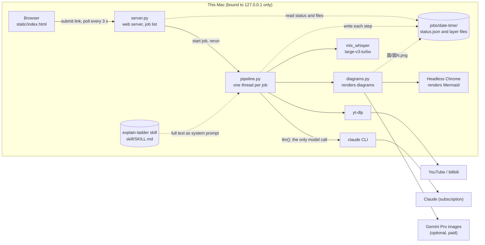
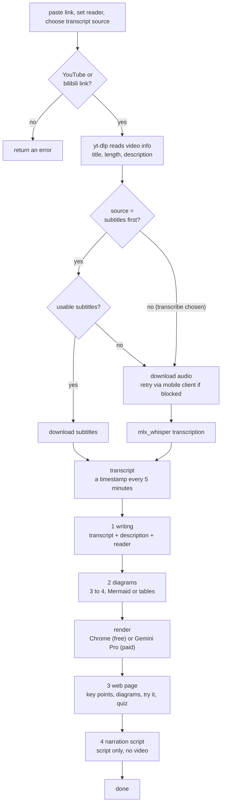
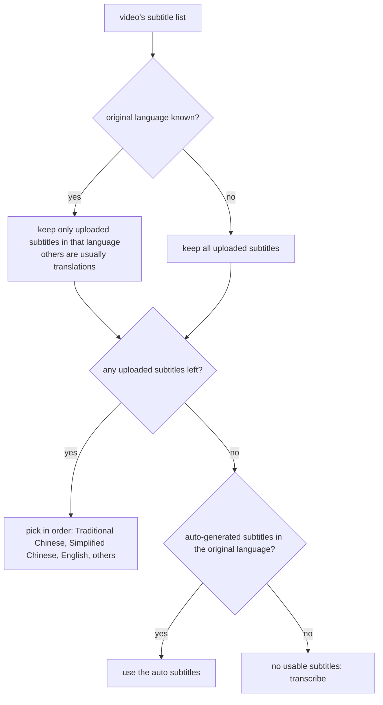

# explain-ladder-web

中文版：[README.md](README.md)

Paste a YouTube or bilibili video link, or an Apple Podcasts episode link, and get the four layers of the explain-ladder skill, generated automatically:

1. **Writing** – a plain, short-sentence summary
2. **Diagrams** – three or four Mermaid diagrams or tables
3. **Web page** – an interactive HTML page (key points, diagrams, try-it-yourself, quiz)
4. **Narration script** – a script for an explainer video (script only, no video)

Podcasts are located through Apple's public lookup API and transcribed locally. Pasting a show link instead of an episode link returns a hint to paste the episode (Share → Copy Link). The server binds to 127.0.0.1 only; it is a personal tool, not a hosted service.

```
start   python3 server.py   →  http://127.0.0.1:8765
test    python3 -m unittest test_pipeline
output  jobs/<date-time>/  逐字稿.txt (transcript), 1_寫作.md, 2_圖解.md, 圖/圖N.png, 3_網頁.html, 4_影片_口白稿.md
```

Options on the page:

- **Reader** – who the writing is for. Empty means a general reader (change the default in `local.json`). The last section of layer 1, "what is useful for the reader", is written for this person.
- **Transcript source** – subtitles first (fast) | transcribe the original Chinese audio (when the subtitles are a translation) | transcribe and auto-detect the language.
- **Upload a .md or .pdf** – instead of a link, pick a file; its text becomes the transcript (download and transcription are skipped). The title is the first `# ` heading, or the file name. PDFs go through poppler's `pdftotext`; a scanned PDF with no text layer is refused with a clear message.
- **House style** – every layer-3 page gets `house.css` (colours, type, components) injected automatically. The model only uses the classes in that file and picks a form by content type (lecture, news digest, data, comparison). Change that one file to change the look.
- **Reader profile** (optional) – upload a .md describing the reader; the whole file is given to the model so it picks what matters to that person. Stored as `jobs/<job>/讀者.md`, not tracked by git.
- **Diagram rendering** – Mermaid (default, free: Chrome renders layer 2's Mermaid and tables) | Gemini infographics (paid, opt in per job).

## Install (on another Mac)

Tested only on Apple Silicon Macs. Windows and Intel Macs are untested.

| Tool | Role | Install |
|---|---|---|
| Python 3.11+ | runs the server | built into macOS, or `brew install python` |
| Claude Code CLI | the model that writes all four layers, on your own Claude subscription | https://claude.com/claude-code, then run `claude` once to log in |
| yt-dlp | fetches subtitles and audio | `brew install yt-dlp` |
| mlx_whisper | local transcription when there are no subtitles | `pipx install mlx-whisper` |
| poppler | text extraction for uploaded PDFs | `brew install poppler` |
| Google Chrome | renders layer-2 Mermaid to PNG (headless) | normal install |
| Pillow | image handling for diagrams | `python3 -m pip install pillow` |

```
git clone https://github.com/phileiny/explain-ladder-web
cd explain-ladder-web
python3 server.py        →  http://127.0.0.1:8765
```

The explain-ladder rules (`skill/SKILL.md`) ship in the repo. Machine-specific settings go in `local.json` (git-ignored); every field is optional:

```json
{"python": "/path/to/python-with-pillow", "whisper": "/path/to/mlx_whisper", "skill": "/path/to/SKILL.md",
 "reader": "default reader description", "env": "/path/to/.env"}
```

Environment variables `EXPLAIN_LADDER_PYTHON`, `EXPLAIN_LADDER_WHISPER`, `EXPLAIN_LADDER_SKILL` and `EXPLAIN_LADDER_READER` override `local.json`.
Gemini infographics are optional and cost money: put `GEMINI_API_KEY=...` in a `.env` at the repo root and `pip install google-genai python-dotenv`.

Known limits: videos without subtitles rely on local transcription, so names and technical terms can come out wrong; layer-3 pages use the `house.css` style, edit that file to restyle; one job runs at a time.

## Architecture

Who talks to whom. Solid lines are calls, dashed lines are file reads and writes.



| File | Role |
|---|---|
| `server.py` | Standard-library-only web server: accepts links, returns the job list, serves files from `jobs/`. On restart, jobs still running are marked interrupted |
| `pipeline.py` | The whole pipeline. `llm()` is the only function that calls the model; switch to the Anthropic API by changing that one function |
| `diagrams.py` | Renders each diagram in `2_圖解.md`: headless Chrome turns Mermaid into PNG (default), or Gemini Pro draws an infographic from the Mermaid render as a layout reference (optional, paid) |
| `static/index.html` | Single page: input, job list, progress, five tabs (writing, diagrams, page, script, transcript) |
| `test_pipeline.py` | Unit tests for link validation, subtitle choice, subtitle-to-text, diagram splitting |

## Flow

One link, from input to all four layers.



### How "usable subtitles" is decided



When YouTube does not label the original language, this rule cannot tell a translated subtitle from an original one (for example a Chinese interview whose only subtitles are machine-translated English). Choose "transcribe the original Chinese audio" on the page in that case.

### Failure and rerun

- A step whose output file already exists is skipped. After a failure, "rerun" only redoes the unfinished steps.
- To redo one layer, delete that layer's file and rerun, or paste the link again.
- A few failed diagrams do not fail the job; the page step uses whatever images exist. Details are in `出圖.log`.
- When the server restarts, running jobs are marked interrupted and can be continued with "rerun".

## Before making a layer-4 video

Each layer compresses the content once more. A headline in the layer-4 script may be a sentence the speaker never said. Before putting a quote under a speaker's name, find it in the transcript first.

## Not done yet

- The layer-4 video itself (only the script exists)
- Anthropic API: the model is called in one function, `pipeline.llm()`; swap it there
- Multi-user use: the tool relies on the logged-in CLI and keys on this Mac, with no accounts or cost control
