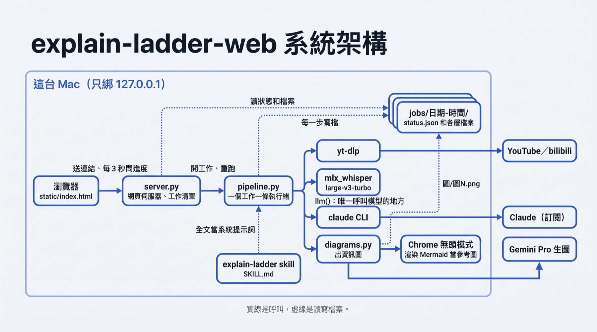
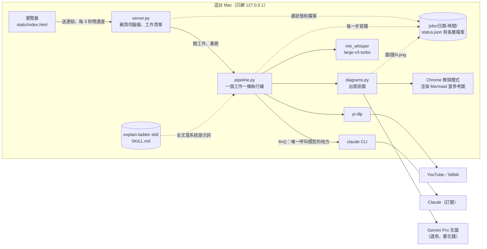
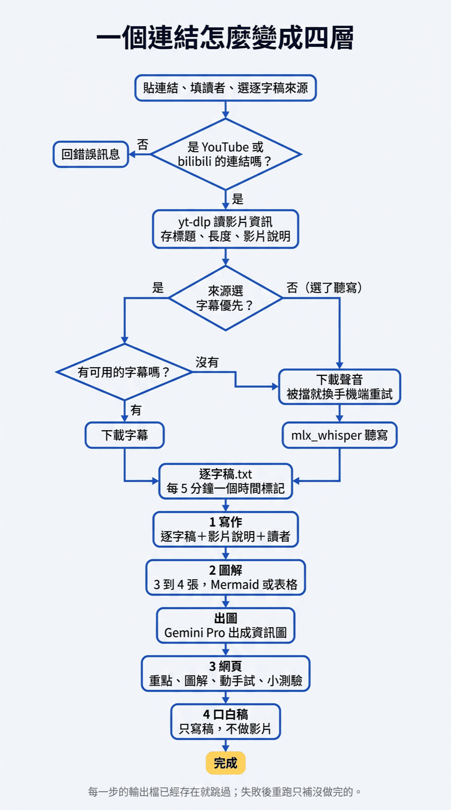
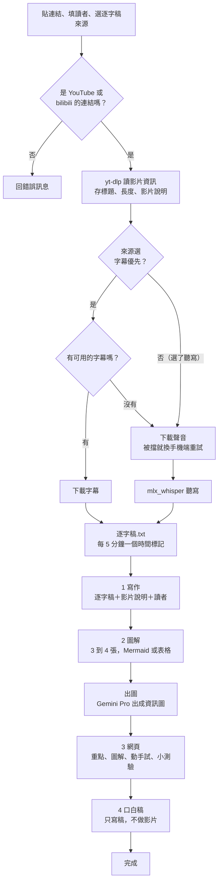
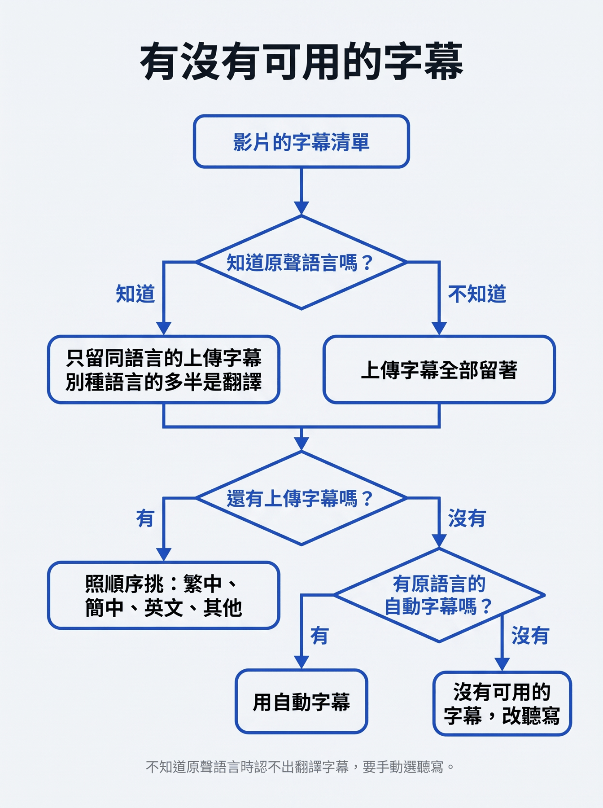
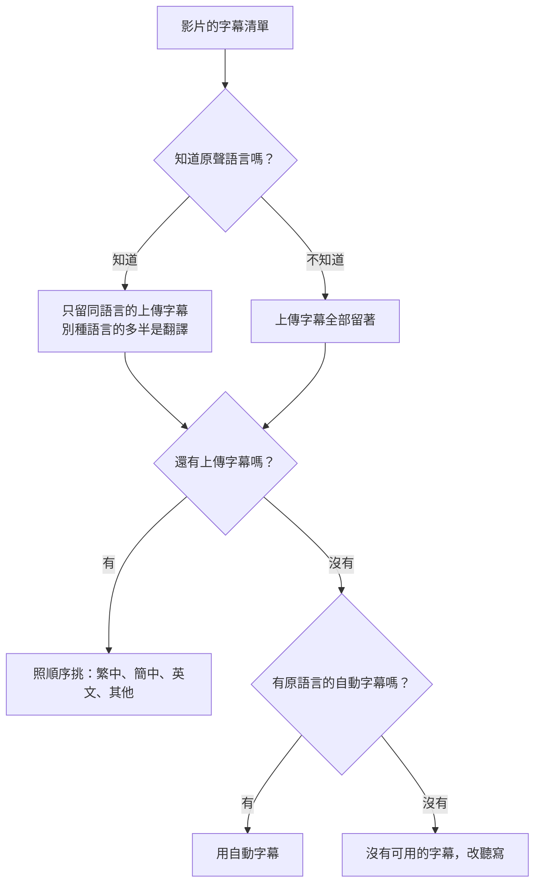

# explain-ladder-web

貼一個 YouTube、bilibili 影片連結，或 Apple Podcasts 的單集連結，自動產出 explain-ladder skill 的四層內容。
Podcast 用 Apple 的公開查詢 API 找音檔，再本機聽寫；貼整個節目的連結會提示改貼單集（單集按「分享」→「拷貝連結」）。只給自己在這台 Mac 上用。

```
啟動   python3 server.py   →  http://127.0.0.1:8765
測試   python3 -m unittest test_pipeline
產出   jobs/<日期-時間>/  逐字稿.txt、1_寫作.md、2_圖解.md、圖/圖N.png、3_網頁.html、4_影片_口白稿.md
```

網頁上可以填兩樣東西：

- **讀者是誰**：不填就是一般讀者（可以在 local.json 的 reader 改預設）。寫作層最後一節「對〈讀者〉有用的地方」會照這個寫。
- **逐字稿來源**：字幕優先（快）｜聽寫中文原聲（字幕是翻譯的時候用）｜聽寫原聲、自動判斷語言。
- **上傳 .md 或 .pdf 檔**：不貼連結，改選一個檔案，內容直接當逐字稿（跳過下載和聽寫）；標題取第一個 `# `，沒有就用檔名。PDF 用 poppler 的 `pdftotext` 抽文字，抽不出字（掃描檔）會直接提示。
- **版型**：第 3 層網頁一律套 `house.css`（星智未來版型：色彩、字型、元件），程式自動插進每一份網頁；模型只用裡面的 class，先依內容類型選形式（講座、新聞週報、資料、比較）。要改整體視覺就改這一個檔。
- **讀者檔**（選填）：上傳一份 .md（例如 `讀者檔.md`），整份交給模型，讓它照讀者在意的事挑重點、寫「對讀者有用的地方」。存在 `jobs/<工作>/讀者.md`，不進 git。
- **出圖**：Mermaid（預設，免費：Chrome 直接渲染第 2 層的 Mermaid 和表格）｜Gemini 資訊圖（要花錢，要用時自己選）。

## 安裝（在另一台 Mac 上跑）

只在 Apple Silicon 的 Mac 上跑過；Windows、Intel Mac 沒試。

| 東西 | 做什麼 | 怎麼裝 |
|---|---|---|
| Python 3.11 以上 | 跑伺服器 | macOS 內建或 `brew install python` |
| Claude Code CLI | 寫四層內容的模型（走你自己的 Claude 訂閱） | https://claude.com/claude-code ，裝好後在終端機跑一次 `claude` 登入 |
| yt-dlp | 抓影片字幕和音檔 | `brew install yt-dlp` |
| mlx_whisper | 本機聽寫（沒字幕時用） | `pipx install mlx-whisper` |
| poppler | 上傳 PDF 時抽文字 | `brew install poppler` |
| Google Chrome | 第 2 層的 Mermaid 圖用 Chrome 渲染成 PNG | 一般安裝 |
| Pillow | 出圖要用 | `python3 -m pip install pillow` |

```
git clone https://github.com/phileiny/explain-ladder-web
cd explain-ladder-web
python3 server.py        →  http://127.0.0.1:8765
```

四層階梯的規則（`skill/SKILL.md`）已經在 repo 裡，不用另外裝。本機設定放 `local.json`（不進 git），欄位都選填：

```json
{"python": "/path/to/python-with-pillow", "whisper": "/path/to/mlx_whisper", "skill": "/path/to/SKILL.md",
 "reader": "讀者預設（不填時用）", "env": "/path/to/.env"}
```

同名環境變數 `EXPLAIN_LADDER_PYTHON`、`EXPLAIN_LADDER_WHISPER`、`EXPLAIN_LADDER_SKILL`、`EXPLAIN_LADDER_READER` 優先於 local.json。
Gemini 出資訊圖是選用功能（要花錢），要用就在 repo 根目錄放 `.env` 寫 `GEMINI_API_KEY=...`，並 `pip install google-genai python-dotenv`。

已知限制：沒字幕的影片靠本機聽寫，人名和專有名詞會錯；第 3 層網頁套的是 `house.css` 這一套版型，要換風格改那一個檔；一次只跑一個工作。

## 系統架構

誰和誰說話。實線是呼叫，虛線是讀寫檔案。



<details><summary>Mermaid 原始碼（圖畫錯或要改時，以這個為準）</summary>



</details>

| 檔案 | 做什麼 |
|---|---|
| `server.py` | 只用 Python 標準函式庫的網頁伺服器。收連結、回工作清單、送出 `jobs/` 裡的檔案。重開時把還在跑的工作標成中斷 |
| `pipeline.py` | 整條流程。`llm()` 是唯一呼叫模型的函數，要換成 Anthropic API 只改這裡 |
| `diagrams.py` | 把 `2_圖解.md` 的每張圖交給 Gemini Pro；先用 Chrome 無頭模式把 Mermaid 渲染成版面參考圖，一起交給它。用 `local.json` 指定的 python 和 `.env`（要 google-genai） |
| `static/index.html` | 單一網頁：輸入框、工作清單、進度、五個分頁（寫作、圖解、網頁、口白稿、逐字稿） |
| `test_pipeline.py` | 連結檢查、挑字幕、字幕轉文字、拆圖解的單元測試 |

要先裝好的東西：`yt-dlp`、`ffmpeg`、`mlx_whisper`、已登入的 `claude` CLI、Chrome、上面那個 venv。

## 流程

一個連結從進來到四層都做完。



<details><summary>Mermaid 原始碼（圖畫錯或要改時，以這個為準）</summary>



</details>

### 「有可用的字幕」怎麼判斷



<details><summary>Mermaid 原始碼（圖畫錯或要改時，以這個為準）</summary>



</details>

YouTube 沒有標原聲語言時，上面的規則認不出翻譯字幕（例：中文訪談只有 AI 翻的英文字幕）。這時候要在網頁上手動選「聽寫中文原聲」。

### 失敗和重跑

- 每一步的輸出檔已經存在就跳過。失敗後按「重跑」，只會補沒做完的那幾步。
- 要重做某一層：刪掉那一層的檔案，再重跑；或重新貼一次連結。
- 出圖有幾張沒成功不會讓整個工作失敗，網頁那一步會用已經有的圖；細節在 `出圖.log`。
- 伺服器重開時，還在跑的工作會標成中斷，可以按「重跑」接下去。

## 這三張圖怎麼來的

`docs/` 的三張圖是把上面的 Mermaid 交給 Gemini Pro 出的（`diagrams.py` 的同一套做法）。改了流程，先改 Mermaid，再重出圖。
系統架構那張出了五次都有一處錯，最後是拿只錯一條箭頭的那版，用 PIL 把那條箭頭擦掉重畫（diagrams.py → Gemini Pro）。

## 做第 4 層影片之前

先讀 `~/sides/story/瑞導IP/解說片/檢查表.md`。最要緊的一條：內容每往上一層就被壓縮一次，第 4 層口白稿的標題可能是原文沒有的句子（2026-10-12「機會在 agent，不在模型」就是這樣來的）。掛著講者名字的大字，先回 `逐字稿.txt` 找到出處。

## 還沒做

- 第 4 層的影片（現在只有口白稿）
- Anthropic API：呼叫模型只有 `pipeline.llm()` 一個函數，要換只改那裡
- 給別人用：現在靠這台 Mac 上已登入的工具和金鑰，沒有帳號和費用控制
